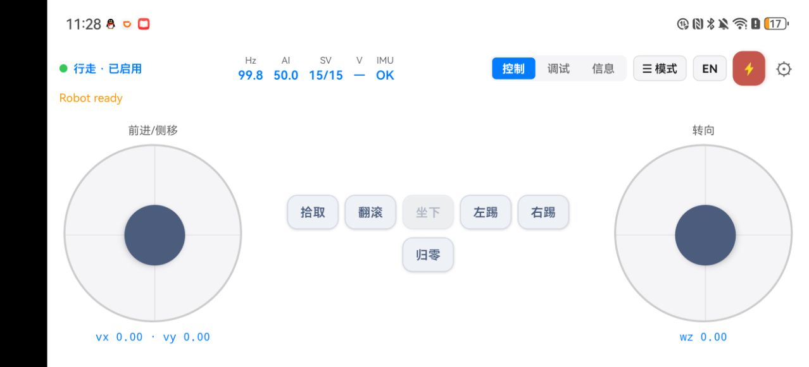
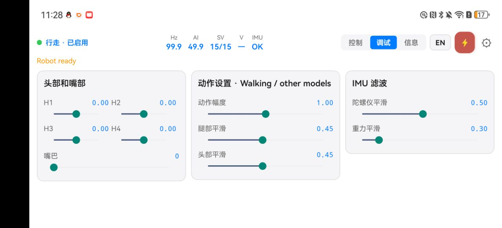
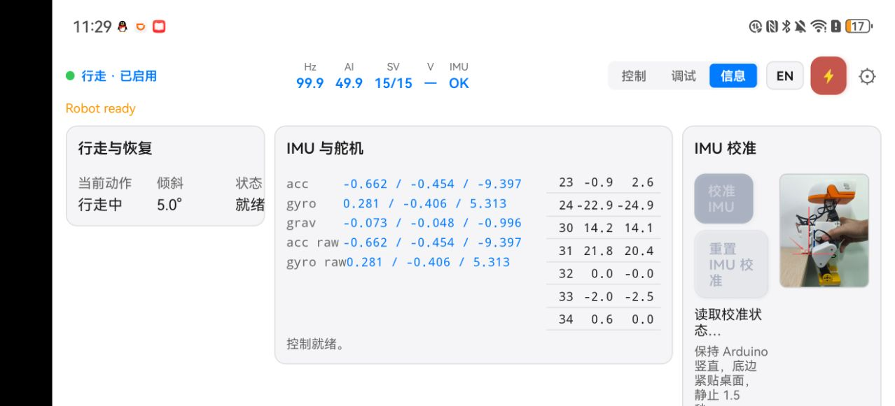

# DuckControl Android App

DuckControl is a native Android app that mirrors the web interface in a landscape game-controller layout. It connects to the robot over Wi-Fi using the same HTTP API.

| Control tab | Tune tab | Info tab |
| --- | --- | --- |
|  |  |  |

### Install

**Option A — Prebuilt APK:**

Install `DuckControl/DuckControl-v1.0.apk` on an Android device (API 24+):

```bash
adb install DuckControl/DuckControl-v1.0.apk
```

**Option B — Build from source:**

```bash
cd DuckControl
export JAVA_HOME="<path-to-jdk-17>"
export ANDROID_HOME="<path-to-android-sdk>"
npx react-native run-android      # debug build + install
# or, for a release APK:
cd android && ./gradlew assembleRelease
# output: android/app/build/outputs/apk/release/app-release.apk
```

React Native 0.76.5, TypeScript, Zustand, and AsyncStorage are used. The release keystore is at `android/app/release.keystore` (alias `duckcontrol`, password `duck123`).

### Connect

1. Open the app. If no host is saved, the settings page appears automatically.
2. Enter the board's IP address (default port **9527**) and tap **Test** to verify.
3. Tap **Save**. The app connects and begins polling `/api/status` at 10 Hz.
4. The top bar shows live metrics: **Hz**, **AI**, **SV** (servos), **V** (voltage), and **IMU** status.

Tap the gear icon (⚙) anytime to open the full-screen settings page, where you can also adjust the virtual joystick size to fit your finger.

### Control tab


| Element | Description |
| --- | --- |
| **Left joystick** | Forward / backward / sideways movement. |
| **Right joystick** | Yaw (turning). |
| **Action buttons** | Pick, Roulade, Sit/Stand, Left kick, Right kick. |
| **Zero motion** | Stops travel while keeping the current mode. |
| **Mode drawer (☰)** | Tap to open a side drawer with mode buttons: Inference only, Default pose, Walk/get up, Skating toggle, and Heading hold toggle. The active mode is highlighted. |
| **Torque off (⚡)** | Unloads all motors immediately. |
| **Language (中/EN)** | Toggle between English and Chinese. Saved across restarts. |

Release a joystick to return it to center. Joystick commands use the same smoothing and ranges as the web interface.

### Tune tab


Three side-by-side panels for real-time adjustment:

- **Head and mouth** — four head sliders (H1–H4) in a 2×2 grid plus a full-width mouth slider.
- **Action settings** — Action scale, Leg α, Head α sliders.
- **IMU filtering** — Angular velocity α and Gravity projection τ sliders.

Release a slider to apply its value. Defaults are restored on app restart.

### Info tab


Three columns in one screen:

- **Walk recovery** — Current action, body tilt angle, and recovery status.
- **Telemetry** — IMU (accelerometer, gyro) and servo positions (14 joints + mouth). Shows control-ready and feedback status.
- **IMU calibration** — Hold the board upright as shown in the pose diagram, tap **Calibrate IMU**, and keep still for 1.5 seconds. Use **Reset** to clear the saved calibration.

### App icon

The launcher icon is generated from `assets/imu-calibration-pose.png`, center-cropped to a square and rendered at all five Android density buckets (mdpi through xxxhdpi).
